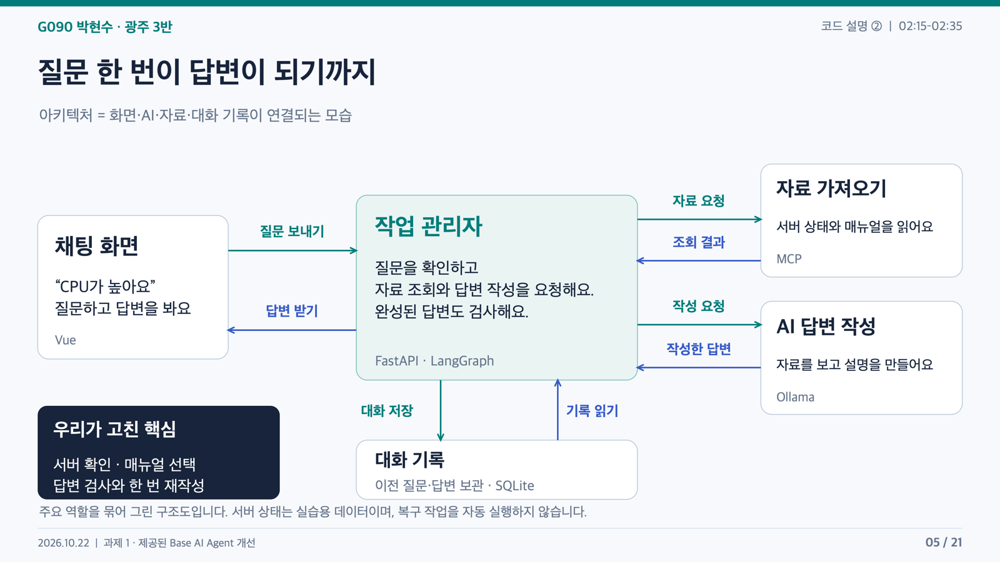
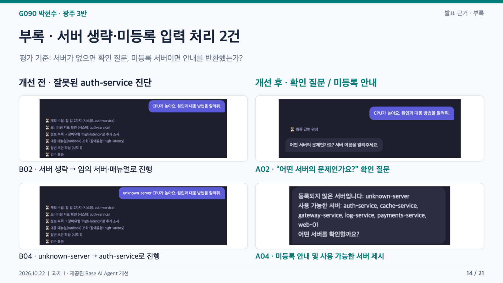
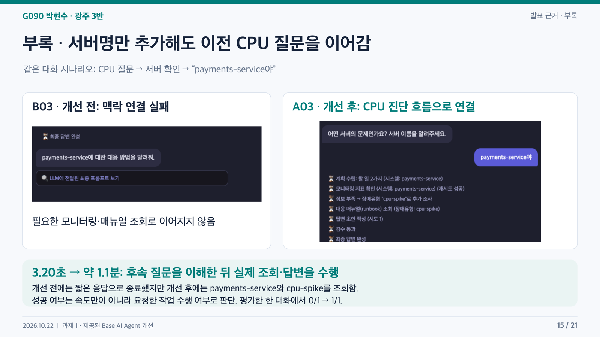
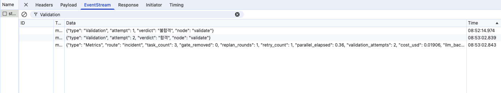
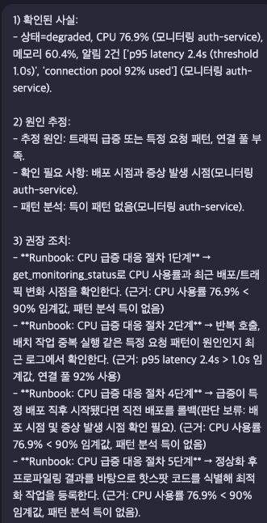
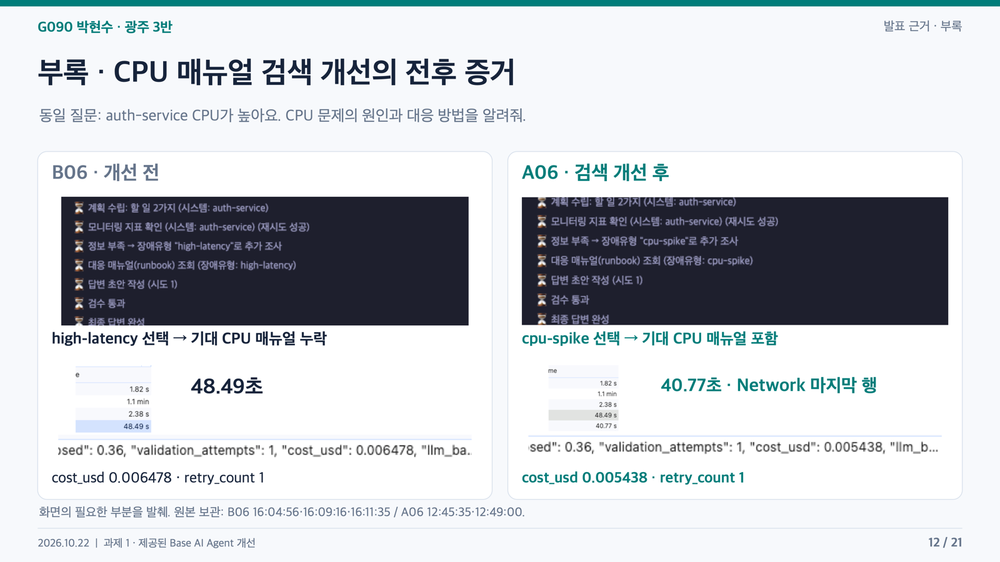
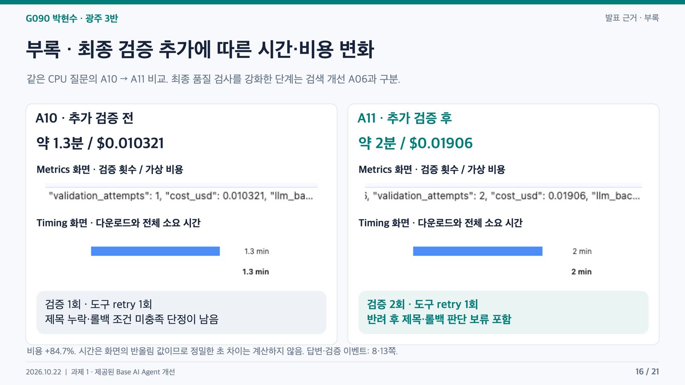
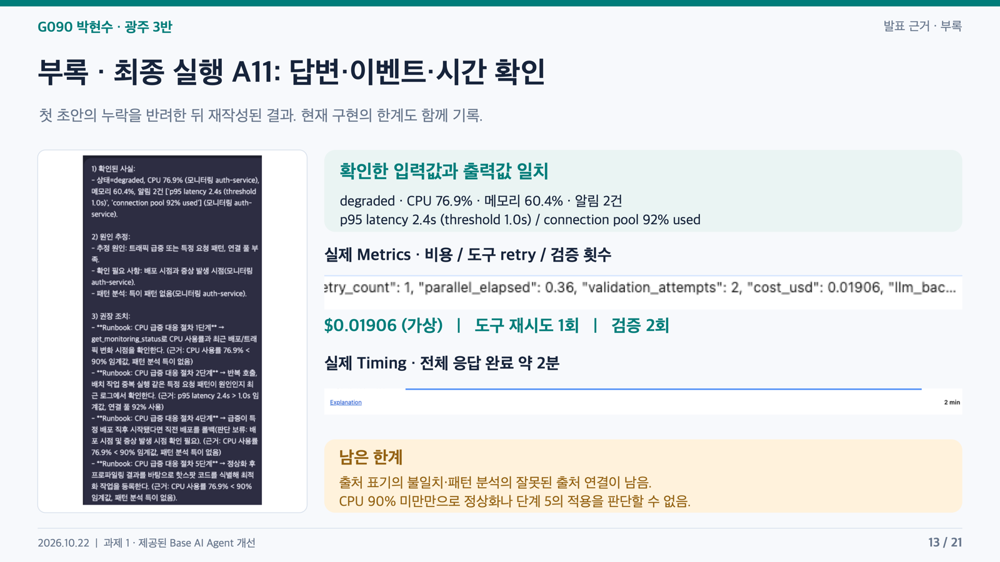

# G090 박현수 | 질문을 확인하고, 근거를 찾아 답하는 AI

**광주 3반 · AI Agent Mini-Project · 과제 1: Base AI Agent 개선 · 2026-10-22**

> “CPU가 높아요”라는 질문에, 어떤 서버인지 확인하고 알맞은 매뉴얼을 찾아 답하도록 개선했다.

교수님이 제공한 운영 진단 Agent를 직접 사용하며 발견한 문제를 고친 기록이다. **대상 확인 → 매뉴얼 선택 → 답변 검사**를 중심으로 개선했다. 기능 소개부터 아키텍처, 실제 코드와 설명, 실행 사진, 측정 결과, 한계까지 이 README에 정리했다.

[1. 진행 사항](#overview) · [2. 아키텍처](#architecture) · [3. 개선 기능·코드·화면](#improvements) · [4. 전후 비교](#evaluation) · [5. 기술·Graph·실행](#technology) · [6. 느낀 점](#reflection) · [7. 한계 및 추가 개선](#limitations)

<a name="overview"></a>

## 1. 진행 사항 — 어떤 문제를 고쳤는가?

실행 화면에 답변이 나오는 것과 사용자의 질문을 제대로 처리하는 것은 달랐다.

| 직접 확인한 상황                         | 고치려던 문제                                                        |
| ---------------------------------------- | -------------------------------------------------------------------- |
| 서버 이름 없이 CPU가 높다고 질문         | 어느 서버인지 확인하지 않고 진단을 진행했다.                         |
| 서버명을 나중에 알려줌                   | 앞에서 말한 CPU 문제와 연결하지 못했다.                              |
| CPU 문제를 질문했지만 지연 알림도 있었음 | CPU 질문에 필요한 매뉴얼이 누락됐다.                                 |
| 답변에서 원인과 조치를 확인              | 문서 제목이 빠지고, 정보가 없는데도 조치가 불필요한 것처럼 판단했다. |

그래서 기능을 많이 늘리는 것보다 **질문에 맞는 대상을 조사하고, 맞는 자료로 답하는 흐름**을 먼저 보완했다. 운영 상태와 매뉴얼은 수업에서 제공한 실습 자료를 사용했다.

### 제공된 기반과 이번에 수정한 부분

FastAPI·Vue·LangGraph·MCP·Ollama·SQLite·의존성 주입·Timeout 재시도·LangSmith 추적은 교수님이 제공한 기반을 활용했다. 이 중 과제에서 보완한 부분은 다음과 같다.

| 파일                  | 추가·수정한 내용                                                                                       |
| --------------------- | ------------------------------------------------------------------------------------------------------ |
| `agent/graph.py`      | 서버 확인, 미등록 안내, 후속 질문 연결, 질문 우선 문서 선택, Runbook 읽기 retry, 답변 검사·재작성 상한 |
| `agent/ollama_llm.py` | 사실·추정·조치 구분, 출처 표시, 조치별 조건 확인을 요구하는 프롬프트                                   |
| `agent/streaming.py`  | 스트림 오류를 화면에 알리는 공통 함수                                                                  |
| `server.py`           | 스트림 오류 처리 연결과 Metrics 전달                                                                   |
| `tests/`              | 스트림·재시도 단위 테스트 8개                                                                          |

아래 코드 발췌는 현재 파일 기준이며 공통 들여쓰기만 정리했다. MCP 조회와 Graph 연결처럼 제공된 구조를 포함하는 부분은 해당 역할을 설명했다. 전체 시스템을 새로 작성한 것으로 표현하지 않는다.

<a name="architecture"></a>

## 2. 쉽게 보는 아키텍처

아키텍처는 **화면, AI, 자료, 대화 기록이 어떻게 연결되는지를 그린 그림**이다.



예를 들어 `auth-service CPU가 높아요`라고 입력하면 이렇게 움직인다.

1. **채팅 화면**에서 질문을 보낸다.
2. **작업 관리자**가 질문을 확인하고 필요한 자료를 요청한다.
3. **자료 조회 기능**이 서버 상태와 대응 매뉴얼을 가져온다.
4. **AI 모델**이 자료를 보고 답변을 만든다.
5. **작업 관리자**가 답변을 검사한다. 기준에 못 미치면 한 번 더 쓰게 하고, 결과를 채팅 화면으로 보낸다.

질문과 답변은 **대화 기록**에 저장해서, 다음 질문에서 앞의 대화를 이어갈 수 있게 한다. 두 번째 검사에서도 실패하면 일반 답변 대신 검증 실패 안내를 보낸다.

| 그림의 쉬운 이름 | 코드에서 사용하는 이름 | 하는 일                                     |
| ---------------- | ---------------------- | ------------------------------------------- |
| 채팅 화면        | Vue                    | 질문 입력, 진행 상황과 답변 표시            |
| 작업 관리자      | FastAPI + LangGraph    | 요청을 받고 자료 조회·작성·검사 순서를 진행 |
| 자료 가져오기    | MCP                    | 모니터링 도구와 대응 매뉴얼에 연결          |
| AI 답변 작성     | Ollama                 | 로컬 AI 모델로 답변 생성                    |
| 대화 기록        | SQLite                 | 이전 질문과 답변 보관                       |

### 실제 파일과 연결 순서

| 쉬운 이름     | 실제 구성                          | 파일                                                                       |
| ------------- | ---------------------------------- | -------------------------------------------------------------------------- |
| 채팅 화면     | Vue 화면과 화면을 제공하는 웹 서버 | [web_chat.html](web_chat.html), [web_demo_server.py](web_demo_server.py)   |
| 작업 관리자   | FastAPI API와 LangGraph 작업 흐름  | [server.py](server.py), [agent/graph.py](agent/graph.py)                   |
| 자료 가져오기 | MCP 클라이언트와 ops 서버          | [agent/mcp_client.py](agent/mcp_client.py), [mcp_server.py](mcp_server.py) |
| AI 답변 작성  | Ollama 모델 호출                   | [agent/ollama_llm.py](agent/ollama_llm.py)                                 |
| 대화 기록     | SQLite 저장·조회                   | [agent/session_store.py](agent/session_store.py)                           |

1. 브라우저가 웹 서버(8600)의 `/chat/stream`에 질문을 보낸다. 웹 서버가 백엔드(8100)에 중계한다.
2. 백엔드가 같은 대화 번호(`thread_id`)의 기록을 읽고 Agent Graph를 실행한다.
3. Graph에서 대상 확인·계획·자료 조회·필요한 분석·초안 작성·검증을 진행한다. 서버가 없으면 먼저 확인 질문으로 종료한다.
4. 자료는 MCP의 stdio 연결로 가져온다. `get_monitoring_status`는 실습 지표를, Runbook Resource는 대응 매뉴얼을 제공한다. 계획 단계에는 표준 절차 Prompt도 사용한다.
5. Ollama(11434)의 `/api/chat`에 모델 요청을 보낸다. `qwen3:0.6b`는 분류·계획 등에도 사용하고, `qwen3:8b`는 답변 작성에 사용한다. 따라서 쉬운 그림의 “AI 답변 작성”은 대표 역할을 표시한 것이다.
6. 진행 상황과 답변은 SSE로 백엔드 → 웹 서버 → 브라우저 순서로 전달한다. SSE는 서버가 화면에 결과를 차례로 보내는 방식이다.
7. 질문과 최종 답변을 SQLite `session.db`에 저장해 다음 대화에서 읽는다.

모니터링 수치는 `data/monitoring.json`에 호출별 변동값을 더한 실습 데이터다. MCP에는 ops와 docs 서버가 연결되지만 이번 운영 진단은 ops 자료를 사용한다. 실제 서버의 복구 명령은 실행하지 않는다.

<a name="improvements"></a>

## 3. 개선한 기능, 실제 코드와 실행 화면

### 첫 번째: 모르면 서버부터 물어보기

**문제** — 대상이 없는 질문이나 잘못된 서버명에도 다른 서버를 진단했다. 서버명을 나중에 말해도 이전 질문을 이어가지 못했다.

**수정** — 서버를 말하지 않으면 확인 질문을 보내고, 미등록 서버이면 사용 가능한 서버를 안내했다. 그다음 `payments-service야`라고 답하면 이전 CPU 요청에 서버명을 붙였다.

**코드** — [`route_node`, `_resolve_followup_query`](agent/graph.py). 후속 연결은 직전 답변이 서버 확인 또는 미등록 안내인 경우, 같은 대화에서 허용된 서버명 답변에 적용된다.

**후속 대화를 연결하는 실제 코드**

원본 파일: [agent/graph.py](agent/graph.py)

```python
def _resolve_followup_query(query: str, history: list[dict]) -> str:
    if len(history) < 2:
        return query

    previous_user, previous_assistant = history[-2:]
    if previous_user.get("role") != "user":
        return query
    if previous_assistant.get("role") != "assistant":
        return query

    previous_answer = previous_assistant.get("content", "")
    if (
        previous_answer != SERVER_NAME_QUESTION
        and not previous_answer.startswith(INVALID_SERVER_PREFIX)
    ):
        return query

    reply = query.strip().rstrip(".!?").strip().lower()
    for name in sorted(KNOWN_SYSTEMS):
        server_replies = {
            name, name + "야", name + "이야", name + "요",
            name + "입니다", name + "예요", name + "이에요",
        }
        if reply in server_replies:
            corrected_query = SERVER_NAME_PATTERN.sub(
                lambda match: (
                    match.group(0).lower()
                    if match.group(0).lower() in KNOWN_SYSTEMS
                    else name
                ),
                previous_user["content"],
            )
            return f"{name}: {corrected_query}"

    return query
```

직전 user·assistant 메시지가 있고, 직전 답변이 서버 확인 질문 또는 미등록 안내일 때만 처리한다. 현재 입력이 등록된 서버명과 허용된 말끝에 해당하면 앞선 사용자 질문의 미등록 이름을 교체하고 서버명을 덧붙인다. 모든 종류의 후속 대화를 이해하는 일반적인 대화 복원 기능은 아니다.

**결과** — 서버 생략·미등록 두 사례가 기대한 안내로 바뀌었고, 서버명만 추가한 한 대화도 실제 조회로 이어졌다.



**서버명을 나중에 알려준 대화의 전후 화면**



개선 전 3.20초의 응답은 필요한 조회를 못 한 결과였다. 개선 후에는 조회·답변까지 수행해 약 1.1분이 걸렸다. 같은 일을 더 빨리 처리한 사례로 해석하지 않았다.

### 두 번째: CPU를 물었으면 CPU 매뉴얼 찾기

**문제** — CPU 문제를 질문했는데 지연·연결 풀 알림의 영향을 받아 필요한 CPU 매뉴얼이 빠졌다.

**수정** — 매뉴얼을 추가로 찾을 때 사용자가 먼저 말한 증상을 우선했다. 질문에 CPU가 있으면 `cpu-spike` 문서 유형을 선택하고 MCP로 읽어 답변의 근거에 넣었다.

**증상에 맞는 문서 유형을 고르는 실제 코드**

원본 파일: [agent/graph.py](agent/graph.py)

```python
def _classify_incident_type(collected: list[dict], query: str = "") -> str:
    """질문의 첫 증상을 우선하고, 없으면 모니터링 알림을 사용한다."""
    query_rules = {
        "cpu-spike": ("cpu", "프로세서"),
        "memory-leak": ("memory", "메모리", "heap", "힙"),
        "high-latency": ("latency", "지연", "느려", "느림", "응답 속도", "커넥션 풀"),
        "network-timeout": ("timeout", "타임아웃", "시간 초과", "네트워크"),
        "disk-full": ("disk", "디스크", "저장 공간"),
        "db-down": ("db down", "db 장애", "데이터베이스 장애", "db 접속 불가"),
    }
    query_text = SERVER_NAME_PATTERN.sub(" ", query).lower()
    matches = [
        (query_text.index(keyword), incident_type)
        for incident_type, keywords in query_rules.items()
        for keyword in keywords
        if keyword in query_text
    ]
    if matches:
        return min(matches, key=lambda match: match[0])[1]

    text = " ".join(
        f"{c['data'].get('status', '')} " + " ".join(c["data"].get("alerts", []))
        for c in collected if c.get("source") == "monitoring"
    ).lower()
    for keyword, incident_type in _INCIDENT_TYPE_RULES:
        if keyword in text:
            return incident_type
    return "db-down"
```

query에서 서버명 패턴을 제거한 뒤 증상 키워드의 등장 위치를 찾는다. 가장 먼저 등장한 증상의 문서 유형을 반환한다. 질문에 증상이 없으면 모니터링 알림 규칙으로 넘어가고, 그래도 일치하지 않으면 db-down을 반환한다. 동의어 전체·오타·부정문을 이해하는 의미 검색이 아니다. replan_check_node에서 Runbook이 없을 때 사용한다.

**MCP로 자료를 가져오는 실제 코드**

원본 파일: [agent/graph.py](agent/graph.py)

```python
needs_runbook = any(tasks[i]["kind"] != "monitoring" for i in research_indices)
runbook_server = runbook_uri_template = None
if needs_runbook:
    runbook_server, runbook_uri_template = await deps.mcp.find_resource_template(
        "get_incident_runbook")

async def run_one(idx: int) -> dict:
    task = tasks[idx]
    await asyncio.sleep(0.35)   # 태스크당 고정 지연 — 병렬 효과를 실측하기 위함
    if task["kind"] == "monitoring":
        data, retries = await with_retry(
            deps.mcp.call_tool, "get_monitoring_status",
            {"system_name": task["target"]})
        return {"idx": idx, "source": "monitoring", "data": data, "retries": retries}
    uri = runbook_uri_template.format(incident_type=task["target"])
    data, retries = await with_retry(
        deps.mcp.read_resource, uri, server=runbook_server
    )
    return {"idx": idx, "source": "runbook", "data": data, "retries": retries}
```

find_resource_template은 연결된 서버 중 Runbook을 제공하는 서버와 URI 형식을 찾는다. run_one은 monitoring이면 Tool을, 나머지이면 Resource를 호출한다. URI 검색 자체는 with_retry로 감싼 범위 밖이다. run_one에 있는 0.35초 지연은 제공된 병렬 조회 실습을 위한 고정 지연이다.

**가져온 자료를 답변 입력에 넣는 실제 코드 — RAG**

원본 파일: [agent/ollama_llm.py](agent/ollama_llm.py)

```python
facts = []
for c in collected:
    if c["source"] == "monitoring":
        d = c["data"]
        facts.append(f"- [근거: 모니터링 {d['system_name']}]: 상태={d['status']}, "
                     f"CPU {d['cpu_percent']}%, 메모리 {d['memory_percent']}%, "
                     f"알림 {len(d['alerts'])}건 {d['alerts']}")
    elif c["source"] == "runbook":
        facts.append(f"- runbook 발췌:\n{c['data'].strip()}")
    elif c["source"] == "analysis":
        facts.append(f"- 패턴 분석: {c['data'].strip()}")
user = f"## 사용자 요청\n{query}\n\n## 수집된 사실\n" + "\n".join(facts)
if feedback:
    user += f"\n\n## 이전 초안에 대한 검증 반려 사유 (반드시 반영)\n{feedback}"
return await self._chat_stream(system, user, on_token=on_token)
```

monitoring·runbook·analysis를 별도 항목으로 구성한다. facts는 모델에 제공할 자료 목록이고 feedback은 이전 검사에서 나온 반려 사유다. 재작성 시 같은 모델 호출에 반려 사유를 덧붙인다. 입력에 패턴 분석을 넣는 것만으로 분석의 정확성이 보장되지는 않는다.

이 흐름은 **문서 선택 → MCP로 본문 읽기 → 자료를 모델 입력에 넣어 답변 작성**이다. 별도 벡터 저장소나 임베딩 검색은 사용하지 않는다.

**결과** — CPU 질문 한 건에서 기대한 CPU 매뉴얼이 포함되었다. 키워드로 문서를 고르는 방식이며 벡터 검색은 사용하지 않는다. 이미 매뉴얼이 있는 경우 모두 재선정하는 기능도 아니다.

### 세 번째: 답변을 한 번 검사하고, 빠진 내용을 다시 쓰게 하기

**문제** — 출처를 쓰라고 지시해도 문서 제목이 빠졌다. 배포 시점을 모르는 상황에서 롤백이 불필요한 것처럼 설명하기도 했다.

**수정** — 문서 제목과 `롤백: 판단 보류` 문구를 검사하고, 빠졌다면 반려 사유를 다음 작성 입력에 전달했다. 최초 초안 다음에 재작성 한 번만 허용했다.

**검증과 재작성 상한을 처리하는 실제 코드**

원본 파일: [agent/graph.py](agent/graph.py)

```python
async def validate_node(state: AgentState, deps: SupervisorDeps) -> dict:
    """Wave 8 — 코드 기준 검증: 30자 이상 + 절차 번호 포함이어야 합격."""
    draft = state["draft"]
    attempts = state.get("validation_attempts", 0) + 1
    missing_titles = []
    for item in state.get("collected", []):
        if item.get("source") != "runbook":
            continue
        match = re.search(r"(?m)^#\s*Runbook:\s*(.+)$", item.get("data", ""))
        if match:
            title = match.group(1).strip()
            if title not in draft:
                missing_titles.append(title)
    needs_rollback_review = any(
        item.get("source") == "runbook" and "롤백" in item.get("data", "")
        for item in state.get("collected", [])
    )
    rollback_pending = any(
        "롤백" in line and re.search(r"판단\s*보류", line)
        for line in draft.splitlines()
    )
    ok = (
        len(draft) >= 30 and "1)" in draft and not missing_titles
        and (not needs_rollback_review or rollback_pending)
    )
    verdict = "합격" if ok else "불합격"
    if not ok and attempts >= 2:
        return {
            "draft": "⚠️ 답변 검증에 실패했습니다. 수집된 자료와 출처를 확인해 주세요.",
            "validation_attempts": attempts,
            "validation_feedback": None,
            "events": state["events"] + [{
                "type": "ValidationStopped",
                "attempt": attempts,
                "verdict": "검증 실패",
            }],
        }
    feedback = None
    if not ok:
        feedback = "답변을 30자 이상으로 작성하고 1) 2) 3) 항목으로 구분하세요."
        if missing_titles:
            feedback += "\n누락된 Runbook 제목: " + ", ".join(missing_titles)
            feedback += "\n각 조치 끝에 실제 제목과 해당 단계 번호를 적으세요."
        if needs_rollback_review and not rollback_pending:
            feedback += "\n배포 시점과 증상 발생 시점이 제공되지 않았습니다."
            feedback += "\n'롤백: 판단 보류'라고 적고, 두 시점의 추가 확인을 안내하세요."
    event = {"type": "Validation", "attempt": attempts, "verdict": verdict}
    return {"validation_attempts": attempts, "validation_feedback": feedback,
            "events": state["events"] + [event]}
```

collected에서 Runbook 제목을 추출하고 초안에 있는지 검사한다. 롤백이 있는 문서는 보류 문구도 요구한다. attempts가 2 이상인데 여전히 실패하면 경고 답변으로 바꾸고 validation_feedback을 None으로 설정한다. 다음 분기에서 finalize로 종료한다. 첫 실패에서는 누락 사유를 feedback으로 만들어 재작성한다. 현재 코드는 배포 정보의 실제 유무를 구조적으로 검사하지 않는다.

**결과** — 최종 A11에서 첫 초안 불합격 → 한 번 재작성 → 두 번째 합격을 확인했다.



입력은 `auth-service CPU가 높아요. CPU 문제의 원인과 대응 방법을 알려줘.`였다. 아래는 실제 최종 답변이다.



**현재 검사 범위:** 길이 30자 이상, `1)` 포함, Runbook 제목 포함, 같은 줄의 롤백·판단 보류 문구를 확인한다. 위의 “합격”은 이 문구 검사를 통과했다는 뜻이다. 아직 해결하지 못한 출처·조건 판단 문제는 마지막 **7절**에 정리했다.

### 결과가 안 나올 때도 알 수 있도록

스트림 오류 처리를 [`safe_stream`](agent/streaming.py)으로 분리했다. 오류가 나면 화면에 안내와 종료 신호를 보내고, [`server.py`](server.py)에서 비용·재시도·검증 횟수를 확인할 수 있는 Metrics 이벤트를 전달하도록 보완했다. 아래 코드에서 정상 응답은 그대로 전달하고 일반 오류는 안내 이벤트로 바꾼다.

원본 파일: [agent/streaming.py](agent/streaming.py)

```python
async def safe_stream(source):
    """응답을 전달하고, 오류가 발생하면 화면에 알린다."""
    try:
        async for chunk in source:
            yield chunk
    except Exception:
        logging.getLogger(__name__).exception("채팅 스트림 처리 실패")
        error = {
            "type": "Error",
            "message": "요청 처리 중 오류가 발생했습니다. 서버 상태를 확인한 뒤 다시 시도해 주세요.",
        }
        yield f"data: {json.dumps(error, ensure_ascii=False)}\n\n"
        yield "data: [DONE]\n\n"
```

정상 chunk는 그대로 전달한다. 일반 예외가 나면 서버 로그에 상세 내용을 남기고 브라우저에는 일반적인 Error 안내와 [DONE]을 보낸다. 내부 예외 문자열은 사용자에게 직접 보내지 않는다. 취소는 단위 테스트에서 별도로 전파 여부를 확인한다. server.py의 StreamingResponse(safe_stream(gen()), ...)에 연결된다.

<a name="evaluation"></a>

## 4. 같은 질문으로 확인한 개선 전후

### 어떻게 측정했는가?

같은 질문 또는 같은 대화 시나리오를 개발 단계별로 한 번씩 보냈다. B는 개선 전, A는 해당 단계의 개선 후 사례다. 브라우저 개발자 도구의 Network·Timing·EventStream과 최종 답변을 기록했다.

| 지표           | 판정·기록 방법                                            | 해석 제한                                                                        |
| -------------- | --------------------------------------------------------- | -------------------------------------------------------------------------------- |
| 지연시간       | 해당 채팅 스트림 요청의 브라우저 Network/Timing 표시      | 모델 계산 시간만을 뜻하지 않음. 반올림된 분 표시에는 정밀 증가율을 적용하지 않음 |
| 비용           | Metrics의 `cost_usd`                                      | 토큰과 코드상 단가로 계산한 가상 비용. Ollama 청구액·전력·장비 비용이 아님       |
| 검색 정확도    | CPU 질문에 기대한 CPU Runbook이 제공되었는지              | 한 문서 선택 사례. 정밀도·재현율이나 전체 정확도가 아님                          |
| retry          | Metrics의 `retry_count`                                   | MCP 조회의 추가 시도. 기본 클라이언트는 최초 모니터링 Timeout을 모의 발생시킴    |
| 대상 서버 처리 | 생략·미등록 2개 입력이 확인 질문·안내로 처리되었는지      | 사전에 확인한 두 사례에 한정                                                     |
| 후속 대화 성공 | 서버명 답변을 이전 요청과 결합해 필요한 조회로 이어갔는지 | 한 대화에 한정                                                                   |

### 사전에 정한 여섯 지표

| 지표                             | 비교 사례                     |       개선 전 |       개선 후 | 해석                             |
| -------------------------------- | ----------------------------- | ------------: | ------------: | -------------------------------- |
| 지연시간                         | CPU 검색 B06 → A06            |       48.49초 |       40.77초 | 7.72초, 약 15.9% 감소            |
| 가상 토큰 비용                   | CPU 검색 B06 → A06            |  0.006478 USD |  0.005438 USD | 약 16.1% 감소                    |
| 검색 정확도에 해당하는 사례 판정 | CPU 검색 B06 → A06            | 기대 문서 0/1 | 기대 문서 1/1 | 해당 질문의 CPU 매뉴얼 포함 여부 |
| 도구 retry 횟수                  | CPU 검색 B06 → A06            |           1회 |           1회 | 변화 없음                        |
| 대상 서버 처리                   | 생략·미등록 B02/B04 → A02/A04 |           0/2 |           2/2 | 해당 두 입력의 기대 동작 충족    |
| 후속 대화 연결                   | B03 → A03                     |           0/1 |           1/1 | 해당 한 대화의 맥락 연결 성공    |



사례별 질문은 한 번씩 보냈다. 반복 평균이나 전체 정확도를 측정한 결과는 아니다. 같은 질문을 사용했지만 모니터링 값은 호출마다 달랐으므로 완전히 고정된 입력 데이터의 비교는 아니다. 또한 **위 표의 개선 후 수치는 각각의 개발 단계 결과**이며 모두 최종 A11에서 다시 측정한 수치가 아니다.

### 최종 검증 강화는 별도로 비교

| 항목                 |                                                  A10 |                           A11 |
| -------------------- | ---------------------------------------------------: | ----------------------------: |
| 화면에 표시된 시간   |                                             약 1.3분 |                        약 2분 |
| 가상 토큰 비용       |                                         0.010321 USD |                   0.01906 USD |
| 도구 retry           |                                                  1회 |                           1회 |
| 답변 검증            |                                                  1회 |       2회: 최초 초안 + 재작성 |
| 출력에서 확인한 변화 | 문서 제목 누락·배포 정보 부재를 조건 미충족으로 단정 | 문서 제목 포함·롤백 판단 보류 |



재작성으로 가상 비용은 약 84.7% 증가했다. 시간은 화면의 반올림 값이어서 정밀한 증가율을 계산하지 않았다. 검색 단계의 40.77초·0.005438 USD와 최종 검증 단계의 약 2분·0.01906 USD를 하나의 최종 성능으로 합치지 않았다.

`retry_count`는 MCP 조회의 추가 시도 횟수이고, `validation_attempts`는 초안 검사 횟수다. 제공된 MCP 클라이언트는 프로세스의 최초 모니터링 호출에 일부러 Timeout을 발생시키는 시연 코드를 포함한다. 따라서 관측한 retry를 실제 운영 서버 장애 횟수로 해석하지 않는다.

### 입력 처리 결과도 따로 확인했다

| 사례                | 개선 전                 | 개선 후                         | 무엇이 달라졌나?              |
| ------------------- | ----------------------- | ------------------------------- | ----------------------------- |
| 서버 생략 B02 → A02 | 임의 서버 진단, 41.49초 | 확인 질문, 1.82초               | 서버를 확인하는 흐름으로 변경 |
| 미등록 B04 → A04    | 다른 서버 진단, 40.15초 | 미등록 안내, 2.38초             | 잘못된 대상 진단 방지         |
| 후속 대화 B03 → A03 | 연결 실패, 3.20초       | 이전 요청과 연결·조회, 약 1.1분 | 실제 조사를 수행하게 됨       |

첫 두 사례의 시간은 장애 진단 완료 시간의 전후 비교가 아니다. 후속 대화도 수행한 작업이 달라 단순한 속도 개선으로 설명하지 않는다. B01~B04의 확보하지 못한 비용은 0으로 채우지 않았고, B05는 짝이 되는 A05가 없어 전후 비교에서 제외했다.

### A11의 최종 실행 화면



A10 입력은 CPU 80.1%·메모리 62.1%, A11 입력은 CPU 76.9%·메모리 60.4%였다. 사용자 질문은 같지만 관측값은 달랐다. A11의 검증 이벤트는 첫 불합격 08:52:14.974, 두 번째 합격 08:53:02.839다. 두 이벤트 사이 간격을 전체 요청 지연시간으로 쓰지 않았다. 캡처 파일의 시각은 자료를 확보한 시각이므로 실행 시각과 다를 수 있다.

### 단위 테스트

스트림 정상 전달·초기 오류·중간 오류·취소 4개, retry 정상·Timeout 후 성공·상한·일반 예외 4개로 총 **8개**다. 업로드용 코드에서도 아래 명령으로 확인했다. 2026-10-22에 업로드용 코드에서 확인한 결과는 **8개 통과, 0.052초**였다. 보고서를 합치는 과정에서 새로 수행한 AI 실험 결과는 아니다.

```bash
./.venv/bin/python3 -m unittest discover -s tests -v
```

모델과 실제 MCP 서버를 호출하지 않는 단위 테스트다. 검색 품질, 답변 의미, 전체 브라우저 동작까지 검증한 결과는 아니다.

```text
Ran 8 tests in 0.052s

OK
```

<a name="technology"></a>

## 5. 사용한 기술, Agent Graph와 실행 방법

| 기술                    | 쉽게 말하면                                  | 이번 과제에서 사용한 부분                                                                                                     |
| ----------------------- | -------------------------------------------- | ----------------------------------------------------------------------------------------------------------------------------- |
| Multi-Agent · LangGraph | 역할을 나누고 다음 작업을 정하기             | 제공된 계획·조회·분석·작성 흐름에 입력 확인·검증 분기를 보완. [`graph.py`](agent/graph.py)                                    |
| MCP                     | AI 프로그램이 도구·자료를 가져오는 연결 방식 | 서버 상태 Tool, 매뉴얼 Resource, 진단 Prompt를 사용. [`mcp_client.py`](agent/mcp_client.py), [`mcp_server.py`](mcp_server.py) |
| RAG                     | 찾은 자료를 참고해 답하기                    | 증상에 맞는 매뉴얼을 읽고 답변 입력으로 전달. 키워드 기반                                                                     |
| 의존성 주입             | 각 작업에 필요한 연결을 전달하기             | `SupervisorDeps`와 `partial`로 모델·MCP 등을 노드에 전달하는 제공 구조 활용. [`deps.py`](agent/deps.py)                       |
| LangSmith               | 어떤 작업을 거쳤는지 추적하기                | 제공된 `@traceable` 코드 활용. 대시보드·원격 수신 확인은 이번 증거에 포함하지 않음                                            |
| 모듈화                  | 역할별로 코드를 나누기                       | 스트림 오류 처리 함수를 별도 파일로 분리. [`streaming.py`](agent/streaming.py)                                                |
| 단위 테스트             | 작은 기능을 자동으로 확인하기                | 정상·오류·취소·재시도 관련 8개. [`tests/`](tests/)                                                                            |

Multi-Agent는 역할을 나눈 실행 흐름을 뜻한다. 독립적인 AI들이 자율적으로 토론하는 구조는 아니다. 조회 단계에는 여러 작업을 묶어 실행하는 기존 코드가 있다.

### Agent Graph는 다음 작업을 어떻게 정하는가?

원본 파일: [agent/graph.py](agent/graph.py)

```python
def _after_validate(state: AgentState) -> str:
    return "finalize" if state.get("validation_feedback") is None else "write"

def build_graph(deps: SupervisorDeps):
    g = StateGraph(AgentState)
    node = lambda fn: partial(fn, deps=deps)   # Wave 13 — 명시적 의존성 주입
    g.add_node("route", node(route_node))
    g.add_node("chat_answer", node(chat_answer_node))
    g.add_node("plan", node(plan_node))
    g.add_node("gate", node(gate_node))
    g.add_node("research", node(research_node))
    g.add_node("replan_check", node(replan_check_node))
    g.add_node("analysis", node(analysis_node))
    g.add_node("write", node(write_node))
    g.add_node("validate", node(validate_node))
    g.add_node("finalize", node(finalize_node))

    g.set_entry_point("route")
    g.add_conditional_edges(
        "route",
        _after_route,
        {"chat_answer": "chat_answer", "plan": "plan", "clarify": END},
    )
    g.add_edge("chat_answer", END)
    g.add_edge("plan", "gate")
    g.add_edge("gate", "research")
    g.add_edge("research", "replan_check")
    g.add_conditional_edges("replan_check", _after_replan_check,
                            {"analysis": "analysis", "research": "research"})
    g.add_edge("analysis", "write")
    g.add_edge("write", "validate")
    g.add_conditional_edges("validate", _after_validate,
                            {"finalize": "finalize", "write": "write"})
    g.add_edge("finalize", END)
    return g.compile()
```

StateGraph는 AgentState를 공유한다. partial(fn, deps=deps)는 각 함수가 호출될 때 LLM·MCP 등을 담은 deps를 전달한다. route의 clarify는 즉시 종료한다. write → validate 뒤 feedback이 남아 있으면 write로 돌아가고 없으면 finalize로 간다. replan_check와 analysis 등 기존 노드도 연결되어 있다.

| 분기                         | 다음 작업           | 사용자가 보는 결과                            |
| ---------------------------- | ------------------- | --------------------------------------------- |
| `route`에서 `clarify`        | 그래프 종료         | 서버 확인 질문 또는 미등록 안내               |
| `replan_check`에서 보완 필요 | `research`로 돌아감 | 자료를 한 번 더 조회                          |
| `validate`에서 첫 불합격     | `write`로 돌아감    | 반려 사유를 반영해 한 번 더 작성              |
| 검증 합격 또는 두 번째 실패  | `finalize` 후 종료  | 검증된 문구를 포함한 답변 또는 검증 실패 경고 |

`SupervisorDeps`는 노드가 사용할 모델·MCP 연결 등을 묶은 객체다. `partial(fn, deps=deps)`는 각 노드에 이 연결을 전달한다. 이 구조를 사용해 노드마다 모델이나 MCP 연결을 새로 만들지 않는다.

### 도구 retry와 답변 재작성은 다르다

원본 파일: [agent/retry.py](agent/retry.py)

```python
async def with_retry(fn, *args, retries: int = 3, base_delay: float = 0.3, **kwargs):
    attempt = 0
    while True:
        attempt += 1
        try:
            result = await fn(*args, **kwargs)
            return result, attempt - 1   # (결과, 재시도 횟수)
        except asyncio.TimeoutError:
            if attempt >= retries:
                raise
            delay = base_delay * (3 ** (attempt - 1))
            await asyncio.sleep(delay)
```

retries=3은 최초 호출을 포함한 총 3회다. 성공 시 attempt - 1을 추가 시도 횟수로 반환한다. asyncio.TimeoutError만 재시도하고 ValueError 등 다른 예외는 즉시 전파한다. 지연은 기본 0.3초, 다음 0.9초다. 이 helper는 제공 기반을 활용했으며 Runbook 읽기에도 연결했다.

| 이름                | 의미                                |
| ------------------- | ----------------------------------- |
| state               | 단계들이 공유하는 작업 기록         |
| query / history     | 현재 질문 / 이전 대화               |
| collected           | MCP 등에서 수집한 자료              |
| draft / final       | 검사 전 초안 / 최종 반환 답변       |
| validation_feedback | 다음 초안에 전달할 반려 사유        |
| validation_attempts | 최초 초안부터 센 검사 횟수          |
| retry_count         | MCP 조회 중 발생한 추가 시도 합계   |
| deps                | 모델·MCP·저장소 등의 연결 객체 묶음 |

### 직접 실행하고 확인하기

기존 실습 폴더에 환경이 준비되어 있다면 설치와 모델 다운로드는 건너뛰고 백엔드와 화면을 실행한다. 확인 환경은 macOS, Python 3.11.15, 로컬 Ollama다. 새 환경에서는 프로젝트 폴더에서 다음과 같이 준비한다. `requirements.txt`는 버전 잠금 파일이 아니며 모든 운영체제에서 새 설치를 검증한 것은 아니다.

```bash
python3 -m venv .venv
./.venv/bin/python3 -m pip install -r requirements.txt
```

기존 `.env`가 있으면 아래 값이 맞는지 확인하고, 새 환경이면 `.env`를 만들어 다음 값을 넣는다. 이 로컬 Ollama 구성에는 외부 API 키가 필요 없다.

```dotenv
LLM_BACKEND=ollama
SUPERVISOR_VERSION=v2
OLLAMA_FAST_MODEL=qwen3:0.6b
OLLAMA_QUALITY_MODEL=qwen3:8b
LANGCHAIN_TRACING_V2=false
LANGSMITH_TRACING=false
```

Ollama가 꺼져 있으면 `ollama serve`로 실행한다. 아래 모델이 없다면 다른 터미널에서 준비한다.

```bash
ollama pull qwen3:0.6b
ollama pull qwen3:8b
ollama list
```

각 터미널을 프로젝트 폴더에서 열어 실행한다.

```bash
# 터미널 1: 백엔드
./.venv/bin/python3 server.py
```

```bash
# 터미널 2: 화면을 제공하는 웹 서버
./.venv/bin/python3 web_demo_server.py
```

채팅 화면은 <http://127.0.0.1:8600>, 백엔드 상태는 <http://127.0.0.1:8100/health>에서 확인한다. 상태 응답의 `llm_backend=ollama`, `supervisor_version=v2`를 확인한다. 종료할 때는 실행 중인 터미널에서 `Ctrl+C`를 누른다.

| 확인 항목     | 보낼 질문                                                          | 기대 동작                                           |
| ------------- | ------------------------------------------------------------------ | --------------------------------------------------- |
| 서버 생략     | `CPU가 높아요. 원인과 대응 방법을 알려줘.`                         | 서버 이름 확인 질문                                 |
| 후속 연결     | 같은 대화에서 `payments-service야`                                 | 앞의 CPU 요청과 연결                                |
| 미등록 서버   | `unknown-service CPU가 높아요.`                                    | 미등록 안내와 사용 가능한 서버 목록                 |
| 매뉴얼과 검증 | `auth-service CPU가 높아요. CPU 문제의 원인과 대응 방법을 알려줘.` | 모니터링·CPU 매뉴얼 조회, 초안 검사, 필요 시 재작성 |

이 표는 재확인 방법이다. 보고서를 합치며 위 질문을 새로 실행한 것은 아니다. `SUPERVISOR_VERSION=v1/v2`는 제공 코드의 실행 경로 구분이며 B06/A06 개선 전후 버전 구분이 아니다.

<a name="reflection"></a>

## 6. 느낀 점

처음에는 답변이 나오면 동작한다고 생각했다. 하지만 서버 이름을 빠뜨리거나, 나중에 서버명만 말하거나, 질문과 알림의 증상이 다르면 결과가 달라졌다. 그래서 최종 답변뿐 아니라 **어떤 대상을 조사했고 어떤 매뉴얼을 읽었는지** 확인하는 것이 필요했다.

출처를 쓰라는 지시도 항상 지켜지지는 않았다. 검사와 재작성을 넣어 누락을 보완했지만, 문구 검사만으로 내용의 타당성까지 확인할 수는 없었다. 또한 재작성하면서 시간과 가상 비용이 증가했다. 이번 작업을 통해 기능이 좋아진 점과 그 대가를 같이 설명해야 한다는 점을 배웠다.

이 보고서의 구조도는 이해하기 쉽게 역할을 묶어 표현했고, 결과 사진은 직접 확보한 실습 화면을 사용했다. 비교 이미지는 실제 화면을 발표 페이지에 배치한 것이다. 원본 응답이나 숫자를 새 측정값으로 바꾼 것은 아니다.

교수님 항목과의 대응: **진행 사항·추가/수정 task는 1·3절, 기술·코드·아키텍처는 2·3·5절, 구현·최종 실행 화면은 3·4절, 전후 수치는 4절, 느낀 점은 6절, 한계·트레이드오프 및 추가 개선은 7절**에 담았다.

<a name="limitations"></a>

## 7. 한계 및 추가 개선 사항

### 개선하면서 감수한 점 — 트레이드오프

트레이드오프는 **개선으로 얻는 효과와 그 대신 감수하는 점**을 함께 보는 것이다.

| 현재 선택                         | 얻은 효과                             | 감수한 점·남은 한계                                                                   |
| --------------------------------- | ------------------------------------- | ------------------------------------------------------------------------------------- |
| 답변 검사와 재작성                | 문서 제목·롤백 보류 문구 누락 보완    | A10→A11에서 약 1.3분→2분, 가상 비용 0.010321→0.01906 USD로 약 84.7% 증가              |
| 재작성을 한 번으로 제한           | 작성·검사가 끝없이 반복되는 위험 제한 | 두 번째도 실패하면 정상 답변을 주지 못하고 경고로 종료                                |
| 추가 매뉴얼 조회를 한 번으로 제한 | 자료를 찾으러 계속 돌아가는 반복 제한 | 보완 후에도 자료가 충분하지 않으면 불충분한 근거로 다음 단계에 넘어갈 수 있음         |
| 질문의 첫 증상 키워드로 문서 선택 | CPU 질문에 필요한 매뉴얼 선택         | 복합 증상·부정 표현을 충분히 이해하지 못하며, 이미 있는 매뉴얼을 모두 재검토하지 않음 |

A10/A11은 같은 사용자 질문을 사용했지만 모니터링 값은 달랐다. 시간·비용 증가는 해당 실행에서 관측한 결과이며, 검증 추가의 순수한 영향이나 모든 질문의 평균으로 일반화하지 않았다. 비용도 실제 Ollama 청구액이 아닌 가상 토큰 비용이다.

### 그래프의 무한 반복 위험을 어떻게 제한했는가?

여기서 무한 반복은 **“답변 작성 → 검사 실패 → 다시 작성”** 또는 **“자료 조회 → 자료 부족 → 다시 조회”**가 계속 이어지는 상황을 말한다. 현재 정상 실행 경로에는 아래 상한이 있다.

| 반복 구간                     | 코드에 있는 종료 조건                                                                | 종료할 때의 동작                                                                       |
| ----------------------------- | ------------------------------------------------------------------------------------ | -------------------------------------------------------------------------------------- |
| 답변 작성·검사                | [`validate_node`](agent/graph.py): 최초 초안 포함 **총 2회 검사**, 재작성은 최대 1회 | 두 번째도 실패하면 `ValidationStopped`와 경고 답변으로 종료                            |
| 부족한 매뉴얼 보완 조회       | [`replan_check_node`](agent/graph.py): `replan_rounds >= 1`                          | 더 조회하지 않고 다음 단계로 진행. 이 분기는 근거가 충분한지 다시 확인하는 검사는 아님 |
| 일시 오류가 난 도구·자료 호출 | [`with_retry`](agent/retry.py): 호출 한 건당 기본 **총 3회**, 추가 시도 최대 2회     | Timeout이 계속되면 예외를 전달. 모든 종류의 오류를 재시도하지는 않음                   |

추가 조회와 기본 retry 상한은 제공된 구조를 활용했고, 답변 검증·재작성 중단 처리를 보완했다. **무한 루프가 실제 발생했다고 측정한 것은 아니다.** 반복 위험에 대한 현재 코드의 대응을 확인한 것이다. 재작성·조회·도구 retry 횟수는 서로 다른 값이다.

### 아직 해결하지 못한 점과 다음 작업

아래 항목은 **향후 개선 계획이며 현재 구현 완료 항목이 아니다.**

| 남은 한계                                                                                                                 | 추가로 할 작업                                                          | 개선 여부를 확인할 기준                                               |
| ------------------------------------------------------------------------------------------------------------------------- | ----------------------------------------------------------------------- | --------------------------------------------------------------------- |
| 문구가 있어도 출처·단계·조건의 의미가 맞는지 판단하지 못함. A11에도 출처 형식·패턴 분석 출처 연결·정상화 조건 문제가 남음 | 조치마다 문서 제목·단계·적용 조건·관측 근거를 따로 받아 대조            | 잘못된 출처와 조건을 잡아내고, 근거가 부족하면 해당 조치를 보류하는지 |
| 롤백 보류 규칙이 배포 시점 정보가 없는 데모에 맞춰져 있음                                                                 | 배포 시점과 증상 발생 시점을 수집하고 정보 유무에 따라 검사             | 배포 정보가 있는 경우와 없는 경우를 구분해 기대한 판단을 내리는지     |
| 보완 조회 상한 뒤에도 근거 부족이 남을 수 있음                                                                            | 상한 도달 시 부족한 근거를 표시하고 확인 질문 또는 조사 중단으로 처리   | 자료가 없는 사례에서 충분한 조사처럼 답하지 않는지                    |
| 반복 횟수 제한은 있지만 앱 차원의 전체 요청 시간·누적 비용 예산 초과 중단은 없음                                          | 전체 요청의 시간·비용 한도와 종료 사유 안내를 추가                      | 오래 걸리는 호출·연속 실패 때 설정한 한도에 맞춰 종료하는지           |
| 키워드 검색과 입력 처리의 평가 사례가 적음                                                                                | CPU 외 메모리·네트워크·복합 증상·부정 표현·미등록 서버 사례를 추가      | 미리 정한 기대 문서·안내 동작과 실제 결과가 일치하는지                |
| 실행마다 모니터링 값이 달라 비교 조건을 완전히 통제하지 못함                                                              | 고정 자료·같은 모델 설정·분리된 대화 이력으로 비교하고 의존성 버전 고정 | 동일 조건에서 지연·가상 비용·검색·retry 결과를 다시 확인할 수 있는지  |
